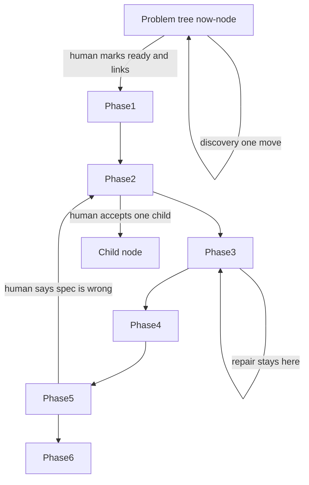

# AGENTS.md — product

This file is the phase machine for one product. It is not the kit that editors change.

## Load order

1. This file
2. `STATE.md` (session pointer)
3. `docs/problem-tree.md` (the map) and the C4 stack named in `STATE.md`
4. `docs/index.md` (where a decision's home is found). The index locates decisions. It does not copy them. Do not look for the home of a decision in this file.
5. Only then the named path from the index. Do not dump the repo or a knowledge tree into context.

If `STATE.md` and `docs/problem-tree.md` disagree about the now-node, the problem tree wins. Say so, then stop.

## Start of every chat

Print three lines, then one loop, then stop.

```text
Now-node: <id> — <one sentence> — depth <vague|framed|ready> — cadence <unset|linear|agile|hybrid> — status <now|later|done|deferred> — link <empty or C4 scope id>
C4 stack: <none, or system / container / component from the outside in>
Scarce resource: <empty, or the root line>
```

Do not chain moves in the same turn. One loop does one move.

## Two zooms

The problem tree and the C4 stack are different zooms. The tree says what subset is being solved, how wide the map is, and how deep that subset is defined. C4 says how the accepted subset is built. A branch does not become a container or a component until the human links them.

`docs/problem-tree.md` is the map the human and the agent both read. Each node is a deliverable:

| Field | Values |
| :--- | :--- |
| id | stable name |
| parent | parent id, or none for the root |
| sentence | one sentence |
| depth | vague, framed, or ready |
| priority | an integer, or unset |
| status | now, later, done, or deferred |
| cadence | unset, linear, agile, or hybrid, stored on this node |
| link | ppre-website |

Cadence is not one switch for the whole project.

Breadth is the number of sibling branches. Depth is how far one branch has been taken (vague, then framed, then ready, and then through the six phases once it is linked). Exactly one node has status now. Later and deferred nodes stay visible. That is the progress view. A vague sibling is not permission to write code.

A scarce-resource line sits on the root (time, money, or attention, in the human’s words). Priority uses that line. If the line is empty and more than one branch is open, the next loop is priority, not more breadth.

## The architecture link

The link is the pointer from a ready problem node down into the C4 architecture stack. It is not a URL, not a citation, and not the success signal.

`link: empty` means no architecture scope exists yet. Filling the link opens the first C4 container for this product. A container is one runnable piece, such as the website. Code is not a container.

Current state of the root node: `docs/problem-tree.md` has `link: ppre-website`. That id is the container in `docs/c4/ppre-website.md`. The blueprint is `docs/c4/ppre-website-blueprint.md`. Mohamed accepted it on 31 Oct 2026. The container is in phase 3. Build has not been started. Do not treat the link as empty. Do not replace `ppre-website` with another id unless the human asks.

The filled signal is: in a blind test, eight out of ten readers correctly identify which Big Five trait a chart is measuring without being told.

Chats may revise the blueprint for that container. They may not write application code until phase 3.

## Cadence is per deliverable

The agent may recommend a cadence for the current node. The human sets it. The human starts a cadence change.

| Cadence | Meaning |
| :--- | :--- |
| unset | No children and no C4 link |
| linear | Children are define-now. Specify every one of them before any of them is built |
| agile | Children are discover-as-we-go. Build them one at a time |
| hybrid | This deliverable names which children are define-now and which are discover-as-we-go |

Define-now children are specified before any of them is built. Discover-as-we-go children are built one at a time after the define-now set is accepted.

Until a node’s cadence is set, the agent does not open a child and does not link it to a C4 scope.

## Spine, after a node is ready

A C4 scope exists only for a node the human has marked ready and linked. Levels are system, container, or component. Code is not a C4 scope. Code is the inside of phase 3 of the current component. A six-phase cycle per function is forbidden. Stack depth max is 3. A product may lower that cap in `docs/nfr.md`. It may not raise it.

A deferred sibling has no C4 link.

| Phase | Name | What the human accepts |
| :--- | :--- | :--- |
| 1 | Problem | The tree node, marked ready, including the NFR rows that apply |
| 2 | Blueprint | Define-now children, or the tasks if this scope is a component. Each task names a check. A public interface records an error shape, a response cap, and a deprecation window |
| 3 | Build | A failing test, then the smallest code that passes. Repair may run here |
| 4 | Adversarial pass | A different chat writes `AUDIT.md` for this scope |
| 5 | Real surface | The running product the human is looking at |
| 6 | Retire | This deliverable missed its date or signal |

Forward motion is not a loop. The human accepts the phase artifact, then that scope advances one phase.

`docs/nfr.md` is filled when the now-node becomes ready. A blank row is a fail. “Not this product” needs a reason.

## Loop contract

Every loop has a trigger, an operation, an end state, and the cadences that allow the agent to recommend it. The human still starts rework, descend, and a cadence change. One loop does one move. The agent does not chain moves in the same turn.



A production loop changes the product or the problem tree. A learning loop changes how the next chat works, and only after a human accepts it in a file. A production repair must not edit the framework to get a green check.

### Discovery loops

These are production loops on the problem tree. They run before a node is linked to C4, and again when the human returns to the tree. One discovery pass is one move (breadth OR depth OR priority), then stop.

### Breadth

- Trigger: the human says the idea is still missing a subset, or the agent recommends one missing subset and the human agrees.
- Operation: add one sibling, depth vague, status later.
- End: the tree shows the new branch, the previous now-node is unchanged, and the log says what was added and what is still not solved.
- Cadences: unset, linear, agile, and hybrid. The agent may recommend one missing subset. The move starts only when the human agrees.

### Depth

- Trigger: the now-node is vague or framed, and the human asks to sharpen it, or agrees to one sharpening pass.
- Operation: fill the next missing piece only (who is hurt, the outcome, one signal, or what is out of scope).
- End: that node’s depth label moves at most one step. It does not jump from vague to ready in one pass unless the human already supplied the missing pieces.
- Cadences: unset, linear, agile, and hybrid. The agent may recommend one sharpening pass. The move starts only when the human agrees.

### Priority

- Trigger: more than one open branch, or the scarce-resource line is set and the current now-node does not fit it. If the scarce-resource line is empty and more than one branch is open, this is the next loop, not more breadth.
- Operation: recommend an order with a one-line reason per branch. The human sets the order.
- End: exactly one now-node, the others later or deferred, and the log states the reason the winner fits the scarce resource.
- Cadences: unset, linear, agile, and hybrid. The agent recommends the order. The human sets it.

### Example: discovery passes

A person says “people misunderstand personality numbers.” Each chat does one pass, then stops.

1. Breadth adds one later branch: facet comparisons. A breadth pass adds one sibling.
2. A later chat’s breadth pass adds one later branch: shock recovery.
3. Priority, with scarce resource “a few evenings,” sets facet comparisons to now and shock recovery to deferred.
4. Depth on the now-node adds one signal: a reader can state the overlap between two groups after one chart. The node is then framed, not ready.

The human can see one current deliverable and one parked branch. The agent does not run those four passes in one turn.

### Repair

- Trigger: linked scope is in phase 3, the check command fails, attempt 1 or 2.
- Operation: stay in phase 3 and fix code, not the tree. Do not edit the framework to get a green check.
- End: the check passes, or attempt 2 fails and the only next loop is a lesson. No third repair.
- Cadences: linear and agile, and hybrid for both define-now and discover-as-we-go children. The agent runs this when the check fails. It does not wait for a separate recommendation.

### Audit return

- Trigger: the human accepts a finding in this scope’s `AUDIT.md`.
- Operation: phase returns to 3.
- End: the finding is fixed or declined. The writing chat does not audit itself.
- Cadences: linear, agile, and hybrid. The agent does not recommend starting this. The human accepts the finding.

### Incident

- Trigger: the human brings a failure from the running product.
- Operation: phase returns to 3, regression test first.
- End: that test passes and the scope returns to phase 5.
- Cadences: linear, agile, and hybrid. The agent does not recommend starting this. The human brings the failure.

### Rework

- Trigger: the human says an accepted artifact is wrong.
- Operation: phase returns to 2, or to the tree if the node itself is wrong.
- End: the human accepts the revision.
- Cadences: linear, and hybrid define-now children: the agent must not start this from a hunch. Agile, and hybrid discover-as-we-go children: the agent may recommend it after phase 5, and it starts only on agreement.

### Descend

- Trigger: the human accepts one child of the now-node.
- Operation: push that child. A define-now child starts at phase 2 when its spec is already in the parent blueprint. A discover-as-we-go child starts at phase 1.
- End: the child is accepted at phase 5, retired, or closed as specified-only. Pop back. The parent now-node stays put.
- Cadences: the human starts descend. The agent does not recommend starting it. Define-now children belong to linear and hybrid. Discover-as-we-go children belong to agile and hybrid.

### Next slice

- Trigger: a discover-as-we-go child just ended, and the parent cadence is agile or hybrid.
- Operation: parent returns to the tree at phase 2. The next decision is the next discover-as-we-go child or stop.
- End: one now-node, no open child. Linear parents do not run this until the define-now list is finished or the human stops.
- Cadences: agile and hybrid. The agent may recommend the next child or a stop. Linear: the agent does not recommend this until the define-now list is finished or the human stops.

### Sunset

- Trigger: the human opens phase 6 because the deliverable missed its date or signal.
- Operation: deprecation first if something outside still calls it.
- End: deprecation recorded, or removed after the window and marked retired on the parent.
- Cadences: linear, agile, and hybrid. The agent does not recommend opening phase 6. The human opens it.

### Example: hybrid chart deliverable

The now-node is “one chart of group overlap.” Cadence hybrid. Define-now children: the dataset boundary, and the rule that forbids absolute country rankings. Those are written in phase 2 before any code. Discover-as-we-go child: the first chart a person can read. That child walks phases 1 through 5. Shock recovery stays a deferred sibling and has no C4 scope. Progress is three visible facts: two constraints specified, one chart in progress, one branch parked.

### Learning loops

These do not push a tree node or a C4 scope.

### Lesson

- Trigger: repair attempt 2 failed, or the same failure class is already in `docs/learn/`, or the human says to keep a rule.
- Operation: one draft under `docs/learn/`.
- End: the human accepts or rejects it in the file. A chat “yes” is not the end.
- Cadences: linear, agile, and hybrid. The agent drafts the lesson. The agent does not treat the draft as accepted.

### NFR revise

- Trigger: a failure shows a row blank, wrong, or waived for a reason that no longer holds.
- Operation: correct that row in `docs/nfr.md`.
- End: the human accepts the row. A return to the tree happens only if the human also starts a rework.
- Cadences: linear, agile, and hybrid. The agent may correct the row. The human accepts it.

### Promotion

- Trigger: the human marks a lesson reusable across projects.
- Operation: the write lands in the framework kit repository, the repo that owns `framework/`. It does not land as a silent edit inside this product.
- End: the product lesson is marked promoted. A repair turn cannot start this.
- Cadences: unset, linear, agile, and hybrid. The agent does not recommend promotion during a repair.

## Observability

Two decisions live in `docs/observability.md`. The agent recommends. The human decides. Bootstrap does not install a product telemetry stack and does not send a trace.

Product observability is an NFR row. During the depth pass that makes a node ready, the agent recommends none, logs, metrics, or traces from how that deliverable fails and whether a request crosses components. The human accepts, changes, or rejects it. Rejection is a filled row with a reason.

Workflow observability is the tree, the stack, and `docs/loop-log.md`: one start line and one end line per loop, including which tree node moved and whether the move was breadth, depth, or priority. The agent recommends Langfuse on top of that log. The human accepts or declines. Do not call Langfuse. Keys stay in the environment, never in the repo and never in chat. A trace carries only metadata. Missing env vars still leave the local log line, and no cloud call is made.

## Open decisions

- Language, runtime, framework, database, hosting: unset until the human names them. Do not add a lockfile, container file, or workflow to force one.
- `routing.mdc` placeholders: if `REPLACE_WITH_` is still there, ask once. Do not guess a path.
- `.cursor/check-cmd`: while it says `NONE`, do not invent a test runner and do not claim a feature is verified. When the human names a command, that one line replaces `NONE`. Repair cannot start while the command is `NONE` or the now-node has no C4 link in phase 3.
- Do not weaken a real check (`true`, `NONE`, skipped tests).

## Log

Each loop writes one start line and one end line to `docs/loop-log.md` before the chat stops.
