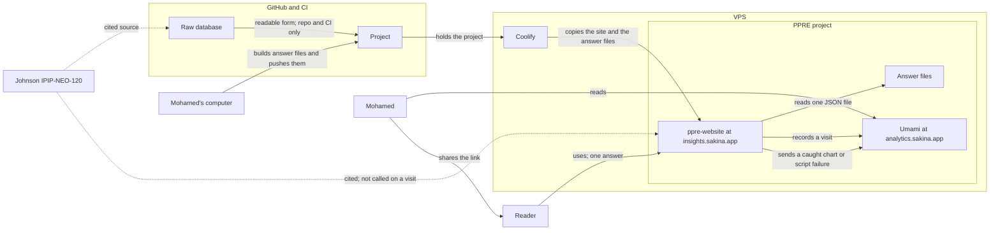

# Context

The picture around `ppre-website`. This is not a container and not a component. A page view does not call GitHub or the original data source.

| Part | Relationship to the website |
| :--- | :--- |
| Reader | Uses the site at `insights.sakina.app`. Receives one precomputed answer at a time, read from a JSON file on the VPS disk. |
| Mohamed | Shares `insights.sakina.app`. Reads visitor analytics and failure logs in Umami at `analytics.sakina.app`. Builds the answer files on his computer and pushes them to GitHub. |
| Umami | Self-hosted on the VPS, in the PPRE Coolify project, with the website. The dashboard is `analytics.sakina.app`. The public site is `insights.sakina.app`. Both are under `sakina.app`. Records page views, popular comparisons, drop-off, referrer, and device. One comparison is one human-readable event name. Also holds the failure log through its error tracking. The personality site stays static. GoatCounter was the lighter analytics alternative considered. |
| Failure log | Umami’s error tracking, on the VPS. When the page catches a chart or script failure, it sends that failure to Umami. The site stays static. A tiny public form that appends to a plain text file, and GlitchTip, were considered. |
| Answer files | Built on Mohamed’s computer and pushed to GitHub. Coolify then copies them onto the VPS. The site reads one JSON file from disk for each comparison. That build does not use a VPS copy of the raw database. |
| Raw database | Lives in the GitHub repo and in CI only. It is a transformation of Johnson’s IPIP-NEO-120 data so the initial file is easier to read. It is cited through that source. The Coolify deploy excludes `data/ipip120.sqlite`. It is not on the VPS. See docs/index.md. |
| GitHub | Holds the project, the raw database, and the answer files. |
| Coolify | Hosted on the VPS. The PPRE project contains the website at `insights.sakina.app` and Umami at `analytics.sakina.app`. The VPS address and the DNS records still to add are in the deploy note. See docs/index.md. It copies the site assets and the answer files. That copy excludes the raw database path. Not used on each page view. |
| Johnson’s IPIP-NEO-120 data | The original source. Cited. The site does not call that source on each visit. The raw database is the readable transformation of this source. |

## Umami event names

One event per comparison pair. The name is human-readable. It is not an opaque id. Five parts, separated by underscores: the target, group A’s gender, group A’s age bracket, group B’s gender, group B’s age bracket. The target is a facet or a trait.

Examples: `anxiety_male_25-34_female_35-44` for a facet, and `neuroticism_male_25-34_female_35-44` for a trait.

Understanding Society is outside version one, so it is not in this picture. Workflow Langfuse: see `docs/observability.md`.
